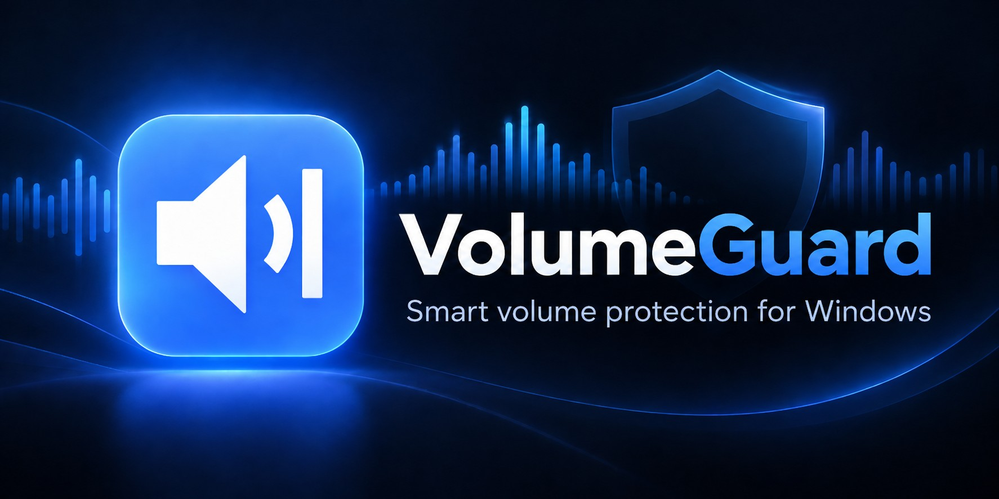
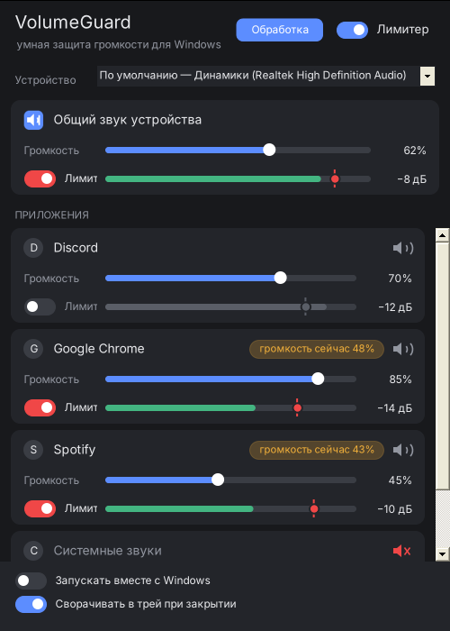
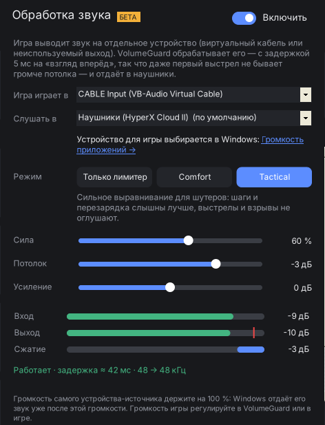

<p align="center">
  
</p>

<p align="center">
  <a href="https://github.com/qqkillua/VolumeGuard/releases/latest"></a>
  
  
  <a href="LICENSE"></a>
</p>

**VolumeGuard** следит за громкостью каждого приложения и не даёт ему стать громче заданного уровня.
Реклама в браузере, взрыв в фильме или уведомление в Discord больше не оглушают: программа сама
плавно убавляет звук, а потом возвращает его обратно.

<p align="center">
  
</p>

## Возможности

- **Каждое приложение отдельно.** Все программы, которые выводят звук, показаны карточками со своей громкостью
  и кнопкой выключения звука. Ползунок тот же, что в микшере громкости Windows.
- **Лимит на приложение.** Включите «Лимит» и поставьте красную метку: приложение не будет громче этого уровня.
  Зелёная полоса показывает текущий уровень, красная — превышение.
- **Общий лимит устройства** для всего звука сразу.
- **Один переключатель** включает и выключает все ограничения; при выключении громкость сразу возвращается.
- **Выбор устройства вывода** или «По умолчанию» — тогда программа следует за устройством Windows.
- **Работает из трея**, запускается вместе с Windows, запоминает настройки каждой программы по имени.
- **Не спорит с вами:** если поменять громкость в микшере Windows или клавишами, программа примет это как новое значение.
- **Не оставляет звук тихим:** если программу закрыли аварийно, при следующем запуске она вернёт громкость, которую убавила.

## Установка

1. Скачайте `VolumeGuard.zip` со страницы [Releases](https://github.com/qqkillua/VolumeGuard/releases/latest).
2. **До распаковки** щёлкните по архиву правой кнопкой → «Свойства» → отметьте «Разблокировать» → «ОК».
3. Распакуйте и запустите `VolumeGuard.exe`. Установка не нужна.

Нужен .NET Framework 4.x — он уже есть в Windows 10 и 11. Держите `vgaudio.dll` в одной папке с exe —
без него не будет работать только обработка звука.

> **Почему Windows предупреждает?** Программа не подписана платным сертификатом, а архив помечен как скачанный
> из интернета. Шаг 2 снимает эту пометку. Можно и не снимать: в окне SmartScreen нажмите «Подробнее» →
> «Выполнить в любом случае». Или соберите программу сами (см. ниже) — собранный на своём компьютере exe
> Windows не останавливает.

## Как это работает

VolumeGuard использует Windows Core Audio. У каждого приложения есть аудиосессия: `ISimpleAudioVolume`
управляет её громкостью, `IAudioMeterInformation` показывает пиковый уровень.

Каждые 2 мс (в отдельном потоке с приоритетом MMCSS) программа читает пик, держит огибающую (мгновенная реакция на рост, плавный спад около 0,6 с)
и выставляет громкость `min(ваша громкость, лимит / уровень)`. После громкого звука громкость возвращается
плавно, примерно за секунду, а в тишине не возвращается вовсе — чтобы звук после паузы не ударил по ушам.

Громкость приложения действует только на звук, который Windows ещё не смешала, поэтому начало внезапного
резкого звука (~10 мс) проходит мимо неё — это слышно как щелчок. Чтобы его не было, включён
«Без щелчка в начале громкого звука»: в этот момент программа на 50 мс убавляет громкость всего устройства.
У большинства гарнитур и звуковых карт она аппаратная и действует на уже смешанный звук, так что щелчок
гасится (так же работает Sound Lock). Подробно — в [docs/limiter.md](docs/limiter.md#ограничения).

Формулы, пример с цифрами и разбор «взрыва в фильме» — в [docs/limiter.md](docs/limiter.md).

## Обработка звука (2.0, бета)

Лимитер на ползунке громкости не успевает за первым выстрелом: он видит звук, когда тот уже звучит.
Для игр в 2.0 появился второй способ — **VolumeGuard сам пропускает звук игры через себя**:

```
игра ──► устройство-источник ──► VolumeGuard: усиление → Comfort / Tactical → лимитер 5 мс ──► наушники
         (виртуальный кабель                                                 
          или свободный выход)                                                
```

Лимитер «заглядывает» на 5 мс вперёд, поэтому ни один сэмпл не громче потолка — даже самый первый выстрел.
Режимы те же, что в [плагине](plugin/README.md):

- **Только лимитер** — громкие звуки упираются в потолок, остальное без изменений.
- **Comfort** — мягко выравнивает: взрывы тише, тихие звуки чуть громче.
- **Tactical** — сильное выравнивание для шутеров: шаги и перезарядка слышнее, выстрелы и взрывы не оглушают.
  Звук делится на низкие (до 150 Гц: моторы, взрывы) и остальные частоты, каждая полоса сжимается отдельно,
  стерео-картина не меняется — направление на шаги остаётся.

<p align="center">
  
</p>

**Как включить**

1. Нужно устройство, куда игра будет выводить звук, но которое вы не слушаете. Виртуальный кабель
   [VB-CABLE](https://vb-audio.com/Cable/) лежит в архиве: в окне «Обработка» нажмите «Установить VB-CABLE»,
   в установщике — «Install Driver», затем перезагрузите компьютер. Появится устройство «CABLE Input».
   Подойдёт и неиспользуемый выход, например HDMI монитора без динамиков.
2. Направьте игру на это устройство: «Параметры Windows» → «Система» → «Звук» → «Громкость приложений» →
   у игры в «Вывод» выберите CABLE Input. Игра должна быть запущена, чтобы появиться в списке.
   Или выберите устройство в настройках звука самой игры, если там это есть.
3. В VolumeGuard нажмите кнопку «Обработка» вверху окна: «Игра играет в» — CABLE Input, «Слушать в» — ваши наушники.
   Включите и выберите режим.

Громкость устройства-источника держите на 100 % — Windows отдаёт его звук уже после этой громкости.
Остальные программы (Discord, браузер) продолжают играть в наушники напрямую, без задержки.

**Честно о задержке.** Путь через второе устройство добавляет задержку, и она зависит от драйверов:

| | источник | буфер | вывод | лимитер | итого |
|---|---|---|---|---|---|
| драйверы с малыми пакетами (Windows 10/11) | ~3 мс | ~11 мс | ~5 мс | 5 мс | **~25 мс** |
| обычные драйверы, пакеты 10 мс | 10 мс | ~25 мс | ~12 мс | 5 мс | **~50 мс** |

Режим малых пакетов VolumeGuard включает сам, если драйвер его поддерживает (встроенные звуковые карты
с драйвером Microsoft «High Definition Audio» — да; многие USB-гарнитуры и VB-CABLE — нет). Из чего сложилась задержка, видно внизу окна.
Беспроводные наушники добавляют своё: Bluetooth 150–250 мс, радио-донгл 15–30 мс — это не изменить программой.
Если важна каждая миллисекунда — выключите обработку одним переключателем, игра снова пойдёт напрямую.

**Как это устроено.** Звук берётся через WASAPI loopback, выводится в общем режиме WASAPI, потоки работают с
приоритетом MMCSS «Pro Audio». У двух устройств свои кварцевые генераторы, и их частоты всегда немного
расходятся (обычно на 0,01–0,1 %), поэтому между ними стоит ресемплер с плавной подстройкой скорости
(не больше ±0,5 %, на слух незаметно). Он же переводит 44,1 ↔ 48 кГц. Буфер подстраивается сам: растёт,
если были пропуски, и медленно уменьшается, если запас не нужен. Если устройство отключили или поменяли его
формат, VolumeGuard переподключается сам. Подробности — в [native/README.md](native/README.md).
Журнал работы: `%APPDATA%\VolumeGuard\audio.log`.

Обработка работает в 64-битной Windows и требует файл `vgaudio.dll` рядом с `VolumeGuard.exe` — он есть в архиве.

**VB-CABLE** — программа VB-Audio Software (Vincent Burel), [www.vb-cable.com](https://vb-cable.com).
VB-CABLE is a donationware, all participations are welcome. Он лежит в папке `VBCABLE` архива без изменений,
по [условиям распространения VB-Audio](https://vb-audio.com/Services/licensing.htm); VolumeGuard с VB-Audio не связан.
Сборка проверяет контрольную сумму пакета и подпись установщиков.

## VolumeGuard Limiter — плагин VST3 / CLAP

Для FL Studio, Ableton, Reaper и других программ с плагинами есть **VolumeGuard Limiter**. Он обрабатывает
сам звук, заглядывает на 5 мс вперёд, и поэтому выход никогда не бывает громче потолка — ни одного сэмпла.
Параметры: Input Gain, Ceiling, Release, Bypass и индикатор Gain Reduction.

Скачать — релиз «VolumeGuard Limiter» на странице [Releases](https://github.com/qqkillua/VolumeGuard/releases),
описание и установка — в [plugin/README.md](plugin/README.md).

## Сборка

Исходники в [`src/`](src). Для `VolumeGuard.exe` достаточно компилятора, который уже есть в Windows:

```bat
build.cmd
```

Или вручную:

```bat
%WINDIR%\Microsoft.NET\Framework64\v4.0.30319\csc.exe /target:winexe /win32icon:assets\app.ico /out:VolumeGuard.exe ^
  /r:System.Windows.Forms.dll /r:System.Drawing.dll /r:System.Core.dll src\*.cs
```

`vgaudio.dll` собирается MinGW-w64 (на Linux или в MSYS2): `native/build.sh`.

На Linux/macOS собирается через Mono (`mcs` с теми же ссылками). `VolumeGuard.exe --demo` открывает интерфейс
с ненастоящими данными — удобно для проверки вёрстки без звука.

**Новая версия.** GitHub Actions собирает exe при каждом пуше в `main`. Чтобы выпустить релиз, поменяйте номер
в `VERSION` и в `src/AssemblyInfo.cs` и добавьте `[release]` в сообщение коммита — архив появится на странице Releases сам.
Как подключена подпись релизов — в [`.signpath/README.md`](.signpath/README.md).

| Файл | Что внутри |
|---|---|
| `src/CoreAudio.cs` | COM-интерфейсы Windows Core Audio |
| `src/Engine.cs` | Настройки, лимитер, работа с аудиосессиями |
| `src/Controls.cs` | Ползунки, переключатели, карточки приложений |
| `src/MainForm.cs` | Главное окно, трей, автозапуск |
| `src/Processing.cs` | Окно «Обработка звука» и связь с `vgaudio.dll` |
| `src/AssemblyInfo.cs` | Название и версия программы |
| `native/` | Звуковой движок `vgaudio.dll` (C++, WASAPI) и его тесты |

## Настройки

Хранятся в `%APPDATA%\VolumeGuard\settings.txt` — обычный текстовый файл.
Если программа упала, подробности будут в `%APPDATA%\VolumeGuard\crash.log`, журнал обработки звука —
в `audio.log` там же.

## Конфиденциальность и изменения в системе

VolumeGuard не подключается к интернету и никуда не передаёт данные. Программа меняет только громкость
приложений и устройства, а в реестре — одну запись автозапуска (`HKCU\Software\Microsoft\Windows\CurrentVersion\Run`,
значение `VolumeGuard`), и только если вы включили «Запускать вместе с Windows». Чтобы удалить программу,
выключите автозапуск, закройте её и удалите папку с exe и `%APPDATA%\VolumeGuard`.

## Code signing policy

Free code signing provided by [SignPath.io](https://about.signpath.io), certificate by [SignPath Foundation](https://signpath.org).

- Committers and reviewers: [@qqkillua](https://github.com/qqkillua)
- Approvers: [@qqkillua](https://github.com/qqkillua)

Signed releases are built from this repository by GitHub Actions; every signing request is approved manually.

**Privacy policy:** This program will not transfer any information to other networked systems unless specifically
requested by the user or the person installing or operating it.

## Лицензия

[MIT](LICENSE) © 2026 Nikita Bainov ([@qqkillua](https://github.com/qqkillua))

---

<details>
<summary><b>English</b></summary>

**VolumeGuard** is a per-app volume limiter for Windows 10/11. Every app that plays sound gets its own volume
slider and an optional ceiling; when an app gets louder than its ceiling, VolumeGuard smoothly turns that app
down and brings it back afterwards. There is also a device-wide limiter, a tray icon, autostart and crash-safe
volume restore. Version 2.0 adds **sound processing (beta)**: route a game to a spare output or a virtual cable,
and VolumeGuard plays it to your headphones through a 5 ms lookahead limiter with Comfort / Tactical
dynamics modes (same DSP as the VST3 plugin), with clock-drift compensation between the two devices
(~25 ms added latency with low-latency drivers, ~50 ms with ordinary 10 ms ones). Download `VolumeGuard.zip` from [Releases](https://github.com/qqkillua/VolumeGuard/releases/latest),
unblock it in file Properties before extracting, and run `VolumeGuard.exe` (requires .NET Framework 4.x, built into
Windows 10/11). Build from source with `build.cmd`. MIT licensed.

</details>
