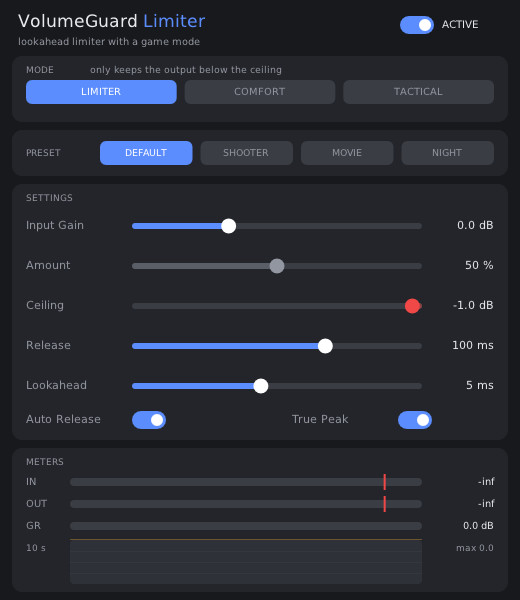

# VolumeGuard Limiter

Плагин-лимитер в форматах **VST3** и **CLAP** для программ, которые умеют загружать плагины:
FL Studio, Ableton Live, Reaper, Bitwig, Studio One, Cubase и другие.

В отличие от программы VolumeGuard, которая двигает ползунки громкости Windows, плагин обрабатывает
сам звук. Он «заглядывает» на несколько миллисекунд вперёд (1…10 мс, по умолчанию 5) и убавляет громкость заранее, поэтому звук на выходе
**никогда** не бывает громче потолка — ни одного сэмпла, даже у самых резких звуков. С включённым **True Peak**
лимитер следит и за пиками *между* сэмплами, которые появляются, когда звуковая карта восстанавливает волну.

<p align="center"></p>

## Установка (Windows)

**Установщиком (проще):**
1. Скачайте `VolumeGuardLimiter-Setup.exe` со страницы
   [Releases](https://github.com/qqkillua/VolumeGuard/releases) (релиз «VolumeGuard Limiter»).
2. Запустите его. Установщик не подписан, поэтому Windows может показать «Система Windows защитила ваш компьютер» —
   нажмите «Подробнее» → «Выполнить в любом случае». Windows попросит права администратора: папка
   Common Files общая для всех пользователей.
3. Отметьте форматы (по умолчанию оба) и нажмите «Установить». Плагин окажется там, где его ищут все программы:
   `C:\Program Files\Common Files\VST3\VolumeGuardLimiter.vst3` и `C:\Program Files\Common Files\CLAP\VolumeGuardLimiter.clap`.
   Если программа с плагином открыта, установщик предложит её закрыть.
4. В своей программе обновите список плагинов и найдите **VolumeGuard Limiter** (производитель qqkillua).

Новая версия ставится поверх старой тем же способом. Удалить: «Параметры» → «Приложения» → «VolumeGuard Limiter (VST3 / CLAP)».

**Вручную из архива:**
1. Скачайте `VolumeGuardLimiter-Windows.zip` и до распаковки: правой кнопкой по архиву → «Свойства» → «Разблокировать» → «ОК».
2. Скопируйте папку `VST3\VolumeGuardLimiter.vst3` в `C:\Program Files\Common Files\VST3\`,
   а файл `CLAP\VolumeGuardLimiter.clap` — в `C:\Program Files\Common Files\CLAP\` (если ваша программа поддерживает CLAP).
3. Обновите список плагинов в программе.

## Режимы

| Режим | Для чего | Что делает |
|---|---|---|
| **Limiter** | музыка, видео, стрим | только держит звук ниже потолка (Ceiling) |
| **Comfort** | фильмы, одиночные игры | мягко прижимает громкие звуки, без резких скачков громкости |
| **Tactical** | шутеры (PUBG, CS2 и т. п.) | заметно тише выстрелы, взрывы и гул машин, громче шаги и другие тихие звуки |

Игровые режимы делят звук на три полосы: ниже 150 Гц (гул двигателей, взрывы), 150 Гц – 2 кГц (основа выстрелов,
голоса) и выше 2 кГц (шаги, перезарядка, двери). Каждая сжимается своим компрессором. В верхней полосе тихие
звуки ещё и **поднимаются** — в Tactical примерно на +7 дБ при Amount 50 % (до +12 дБ при 100 %), в Comfort
немного. Совсем тихое (тише −72 дБ, шипение) не поднимается. Потом общий уровень поднимается, а лимитер в конце
следит за потолком. Оба канала всегда обрабатываются одинаково, поэтому направление звуков не меняется.
Ручка **Amount** задаёт силу: чем больше, тем ближе по громкости выстрелы и шаги.

Замеры на синтетическом «шутере» (тесты в [`tests/test_game.cpp`](tests/test_game.cpp)), Amount 50 %:

| | Выстрелы громче шагов на | Гул машины громче шагов на |
|---|---|---|
| Без обработки | 37,6 дБ | 30,0 дБ |
| Comfort | 31,5 дБ | — |
| Tactical | 22,7 дБ (при Amount 100 % — 15,5 дБ) | 5,2 дБ |

Такая обработка работает только с готовым звуком на выходе, как эквалайзер в программе для наушников, и в саму игру не вмешивается.

## Параметры

| Параметр | Диапазон | По умолчанию | Что делает |
|---|---|---|---|
| Mode | Limiter / Comfort / Tactical | Limiter | режим обработки, см. выше |
| Amount | 0…100 % | 50 % | сила игрового режима |
| Input Gain | −12…+24 дБ | 0 дБ | усиление перед обработкой — чем больше, тем громче и плотнее звук |
| Ceiling | −30…0 дБ | −1 дБ | потолок: громче этого уровня на выходе не будет |
| Release | 1…1000 мс | 100 мс | как быстро громкость возвращается после пика |
| Auto Release | вкл/выкл | вкл | после одиночного пика возврат вдвое быстрее Release, при долгой громкой сцене — до 3 раз медленнее, чтобы громкость не «качалась» |
| True Peak | вкл/выкл | вкл | ограничивать и пики между сэмплами (4× интерполяция) |
| Lookahead | 1…10 мс | 5 мс | насколько вперёд лимитер смотрит — это и есть задержка плагина, см. ниже |
| Bypass | вкл/выкл | выкл | пропускать звук без обработки (задержка сохраняется) |
| Gain Reduction | −40…0 дБ | — | индикатор: насколько сейчас убавлено |
| Input / Output Level | −60…+6 дБ | — | индикаторы уровня на входе и выходе |

В окне плагина ползунки двигаются мышью или колёсиком, двойной щелчок возвращает значение по умолчанию.
Под индикаторами — график ослабления за последние 10 секунд: видно, как часто и насколько лимитер убавлял звук.

## Пресеты

Кнопки в окне плагина (и список пресетов в программе-хосте):

| Пресет | Режим | Amount | Ceiling | Release |
|---|---|---|---|---|
| **Default** | Limiter | — | −1 дБ | 100 мс |
| **Shooter** | Tactical | 60 % | −3 дБ | 80 мс |
| **Movie** | Comfort | 50 % | −2 дБ | 150 мс |
| **Night** | Comfort | 100 % | −12 дБ | 200 мс |

Подсвечивается пресет, с которым совпадают текущие настройки. Auto Release во всех пресетах включён.
Красная метка на индикаторах IN и OUT — это потолок: красная часть полосы IN показывает, насколько вход громче потолка.

## Lookahead: задержка или мягкость

Лимитер видит пик за **Lookahead** миллисекунд и успевает плавно убавить громкость к его приходу. Это время
и есть задержка звука в плагине:

| Lookahead | Задержка при 48 кГц | Когда выбирать |
|---|---|---|
| 1–2 мс | ≈ 1,2–2,2 мс | слушать себя «вживую» — мониторинг в Elgato Wave Link, игра, где важна каждая миллисекунда |
| 5 мс (по умолчанию) | ≈ 5,2 мс | обычный выбор: незаметная задержка и чистый звук |
| 8–10 мс | ≈ 8,2–10,2 мс | самый мягкий звук на басах и взрывах: убавление растянуто на большее время |

Потолок держится при любом значении — меняется только то, насколько плавно громкость убавляется перед пиком:
при 1 мс резкий громкий бас может слегка «хрустнуть», при 10 мс — нет.

Lookahead меняет саму задержку, поэтому её нельзя автоматизировать. При смене звук на мгновение затихает
(2 мс затухание, новая задержка, 2 мс нарастание — без щелчка), а программа-хост получает новую задержку
и сама заново выравнивает дорожки. В окне плагина значение отправляется хосту, когда отпускаете ползунок.

## Технические детали

- Задержка = Lookahead + 8 сэмплов на поиск пиков между сэмплами: при 5 мс и 48 кГц — 247 сэмплов (≈ 5,2 мс),
  при 1 мс — 55, при 10 мс — 487. Плагин сообщает её программе, и та сама выравнивает дорожки.
  Выключение True Peak задержку не меняет.
- Стерео со связанными каналами: оба канала убавляются одинаково, стереокартина не плывёт.
- Нагрузка — около 0,3 % одного ядра процессора в режиме Limiter и около 1 % в игровых режимах.
- Как именно считается громкость — в комментарии в начале [`src/LimiterDsp.hpp`](src/LimiterDsp.hpp).

## Проверки

- [`tests/test_limiter.cpp`](tests/test_limiter.cpp) прогоняет лимитер на шуме с пиками, синусах, щелчках и тишине
  при 44,1, 48 и 96 кГц в случайных размерах блоков и проверяет, что потолок не превышен ни разу — в том числе
  с выключенной страховочной обрезкой, то есть его держит сам алгоритм. Ещё проверяется, что тихий звук проходит
  без изменений, задержка совпадает с заявленной, громкость восстанавливается после пика, Bypass работает.
  Auto Release: после одиночного выстрела громкость возвращается быстрее (124 мс против 204), а при очереди
  «качается» почти вдвое меньше (3,2 дБ против 6,0). True Peak: синус на 12 кГц, у которого сэмплы на −3 дБ, а волна
  на 0 дБ, и громкий шум до 18 кГц — на выходе волна не выше потолка (без True Peak — до +1 дБ выше).
  Lookahead: при каждом значении от 1 до 10 мс и смене прямо во время громкого шума потолок держится, задержка
  совпадает с заявленной; смена на громком синусе не даёт щелчка, звук возвращается меньше чем за 0,1 с.
- [`tests/test_game.cpp`](tests/test_game.cpp): три полосы в сумме дают ровную АЧХ (±0,001 дБ), тихий звук на
  3 кГц в Tactical становится на ~7 дБ громче такого же на 500 Гц, а шипение на −85 дБ не поднимается.
- Каждая сборка проходит [pluginval](https://github.com/Tracktion/pluginval) на максимальной строгости,
  включая валидатор VST3 от Steinberg. Установщик тоже проверяется на Windows при каждой сборке: ставится
  без вопросов, файлы совпадают с архивом, установленный VST3 проходит pluginval, удаление ничего не оставляет.

## Сборка

Под Windows плагин собирается компилятором MinGW-w64 (DPF рассчитан на него). Проще всего — из Linux или WSL:

```
git submodule update --init --recursive
cmake -S plugin -B build-win -DCMAKE_BUILD_TYPE=Release -DBUILD_TESTING=OFF \
      -DCMAKE_TOOLCHAIN_FILE=cmake/mingw-w64-x86_64.cmake
cmake --build build-win
```

Тесты лимитера (на Linux): `cmake -S plugin -B build && cmake --build build && ctest --test-dir build`.
GitHub Actions делает и то и другое, а затем проверяет плагин в pluginval на Windows.

Плагин построен на [DPF](https://github.com/DISTRHO/DPF) (лицензия ISC). VST3 is a trademark of Steinberg Media Technologies GmbH.
